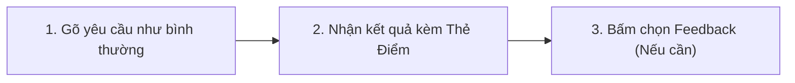
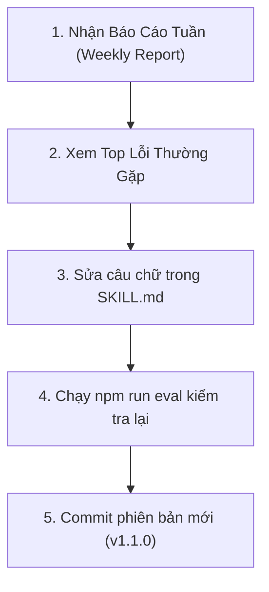

# TÀI LIỆU CHUYỂN GIAO & BÀN GIAO NỘI BỘ (TEAM TRANSFER GUIDE)
## HỆ THỐNG ĐÁNH GIÁ CHẤT LƯỢNG KỸ NĂNG AI (AI SKILLS EVALUATION SYSTEM)

> **Mục tiêu tài liệu:** Dành cho **Repo Owner** dùng để trình bày, giải thích và bàn giao cho toàn bộ đội ngũ phát triển sản phẩm (**PM, BA, QC/QA, Developers**) về hệ sinh thái AI Skills mới.

---

## 1. SO SÁNH: TRƯỚC VÀ SAU KHI CÓ HỆ THỐNG EVALUATION

| Tiêu chí | Trước đây (Chưa có Evaluation) | Hiện tại (Đã có Evaluation) |
| :--- | :--- | :--- |
| **Cách AI làm việc** | Sinh văn bản theo cảm tính, dựa vào hướng dẫn tĩnh (`SKILL.md`). | Sinh văn bản và **tự động đối soát ngay lập tức** với Bộ tiêu chuẩn chất lượng (`evaluation.yaml`). |
| **Chất lượng đầu ra** | Hên xui, lúc đủ lúc thiếu; AI hay bỏ quên kịch bản kiểm thử (Gherkin) hoặc ma trận truy vết. | **Được bảo đảm bằng cổng chất lượng (Quality Gate)**: Chỉ công nhận ĐẠT (`PASS`) khi đủ 100% mục bắt buộc và đạt từ 80/100 điểm. |
| **Phát hiện lỗi rò rỉ** | Người đọc phải tự soi từng dòng xem AI có viết nhầm mã code/SQL vào tài liệu BA hay không. | **Tự động bắt lỗi tức thì**: Quét sạch các lỗi cấm kỵ (như rò rỉ SQL vào PRD/FRD) và đánh trượt ngay lập tức (*Instant Fail*). |
| **Đo lường & Phản hồi** | Mù số liệu: Không ai biết AI viết tốt hay dở, người dùng gặp lỗi chỉ biết tự sửa tay trong âm thầm. | **Minh bạch 100%**: Thu thập tỷ lệ Đạt chuẩn (Pass Rate), tỷ lệ phải làm lại (Rework Rate) và danh sách lỗi thường gặp. |
| **Cách cải tiến Skill** | Repo Owner sửa prompt theo trực giác cá nhân. | **Cải tiến dựa trên bằng chứng (Evidence-based)**: Nhìn vào Báo cáo tuần để biết chính xác câu chữ nào cần sửa. |

---

## 2. NHỮNG LỢI ÍCH VƯỢT TRỘI (PROS & GIÁ TRỊ MANG LẠI)

### 🎯 1. Dành cho Team Members (PM, BA, QC, Devs)
* **Tiết kiệm thời gian rà soát:** Không còn mất công đọc đi đọc lại để kiểm tra xem tài liệu có bị thiếu mục quan trọng nào không.
* **Đầu ra chuẩn mực, sẵn sàng sử dụng ngay:** Mỗi tài liệu sinh ra (PRD, BRD, WBS, Test Specs) đều đảm bảo đầy đủ tiêu chí nghiệm thu của dự án.
* **Tiếng nói được ghi nhận:** Nút góp ý (Feedback) giúp phản ánh trực tiếp mong muốn của bạn về cho người quản lý kỹ năng.

### 🛡️ 2. Dành cho Repo Owner (Người quản lý kho kỹ năng)
* **Nắm bắt sức khỏe kho kỹ năng:** Biết chính xác trong 20 skills, skill nào đang hoạt động xuất sắc, skill nào đang bị người dùng phàn nàn.
* **Tối ưu hóa có cơ sở:** Báo cáo chỉ thẳng mặt "triệu chứng bệnh" (ví dụ: *AI hay quên viết deadline trong WBS*) $\rightarrow$ chỉ cần bổ sung đúng 1 câu vào `SKILL.md` là giải quyết dứt điểm.
* **Tự tin khi phát hành:** Có bộ kiểm thử đối chứng (Benchmark) để test trước tại máy, đảm bảo prompt mới không làm hỏng các tính năng cũ.

### 🏢 3. Dành cho Toàn bộ Dự án & Tổ chức
* **Chuẩn hóa quy trình SDLC:** Toàn bộ tài liệu nghiệp vụ và kỹ thuật trong công ty đều tuân theo một ngôn ngữ chung và quy chuẩn thống nhất.
* **An toàn & Bảo mật tuyệt đối:** Áp dụng nguyên tắc *Strict Data Minimization* — Hệ thống chỉ lưu điểm số và mã lỗi, **không bao giờ lưu trữ hay gửi thông tin dự án mật ra ngoài**.

---

## 3. LÀM SAO BIẾT MỘT SKILL ĐÃ XÀI TỐT HAY CHƯA? (BỘ 4 THƯỚC ĐO ĐỊNH LƯỢNG)

Trước đây, ta chỉ đánh giá cảm tính (*"nghe bảo viết cũng ổn"*, *"hôm qua có người chê"*). Với hệ thống mới, câu hỏi này được trả lời chính xác bằng **4 thước đo định lượng khách quan**:

1. **Thước đo 1: Điểm số bài làm tức thì ($\ge 80 / 100$ điểm)**
   * Mỗi tài liệu sinh ra đều được chấm theo thang điểm 100 và quét lỗi cấm kỵ.
   * Nếu $\ge 80$ điểm và 0 lỗi cấm $\rightarrow$ 🟢 **ĐẠT (PASS)**: Sản phẩm đạt chuẩn chuyên nghiệp ngay tại phiên chat.
2. **Thước đo 2: Tỷ lệ Đạt Chuẩn Tuần (Weekly Pass Rate $\ge 80\%$)**
   * Theo dõi trong Báo Cáo Tuần:
     * **Pass Rate $\ge 80\%$** $\rightarrow$ 🟢 **Skill hoạt động xuất sắc & Ổn định**.
     * **Pass Rate $50\% - 79\%$** $\rightarrow$ 🟡 **Tạm ổn / Cần quan sát thêm**.
     * **Pass Rate $< 50\%$** $\rightarrow$ 🔴 **Chưa đạt chuẩn**: Đa số người dùng chạy đều bị thiếu mục hoặc lỗi.
3. **Thước đo 3: Tỷ lệ Phải Chỉnh Sửa (Rework Rate $< 20\%$)**
   * Đo lường sự hài lòng thực tế của người dùng:
     * **Rework Rate thấp ($< 15 - 20\%$):** Đa số người dùng chọn *"Rất hài lòng, dùng được ngay"* $\rightarrow$ Skill đáp ứng đúng nhu cầu.
     * **Rework Rate cao ($> 40\%$):** Người dùng liên tục bấm *"Cần bổ sung/sửa đổi"* $\rightarrow$ Prompt của skill đang thiếu ý, cần cập nhật.
4. **Thước đo 4: Kiểm Thử Đối Chứng (Benchmark Regression Test)**
   * Mỗi khi cập nhật `SKILL.md`, chỉ cần gõ `npm run eval <tên-skill>`:
   * Nếu bài mẫu chuẩn (`Good`) đạt $\ge 80$ điểm và bài viết ẩu (`Flawed`) bị máy chỉ ra đúng lỗi $\rightarrow$ Bộ quy chuẩn của skill đang kiểm soát chất lượng cực kỳ chặt chẽ.

> 💎 **Điểm đắt giá nhất:**  
> Hệ thống không chỉ trả lời *"Tốt hay Chưa tốt"*, mà nếu chưa tốt, nó **chỉ thẳng mặt lý do** (ví dụ: *lỗi thiếu kịch bản Gherkin*) để Repo Owner **biết chính xác cần sửa câu nào trong `SKILL.md`!**

---

## 4. BẢN CHẤT & VAI TRÒ CỦA THƯ MỤC `benchmarks/` (BỘ ĐỀ KIỂM THỬ ĐỐI CHỨNG)

Trong mỗi thư mục kỹ năng, bạn sẽ thấy một thư mục con tên là `benchmarks/` chứa các file `.json`. Đây là **thành phần cốt lõi** giúp hệ thống đánh giá hoạt động hoàn toàn tự động và chính xác:

### 4.1. Thư mục `benchmarks/` chứa những gì?
Mỗi file `.json` bên trong (ví dụ: `tc-01-ecommerce-cart-prd.json`) là một bài kiểm thử mô phỏng một tình huống thực tế của dự án, bao gồm:
* **Prompt:** Câu lệnh yêu cầu mẫu mà người dùng sẽ gõ.
* **Expected Sections:** Danh sách các mục bắt buộc phải xuất hiện trong bài làm.
* **Cặp bài mẫu đối chứng thần thánh:**
  * **`sample_good_output` (Mẫu chuẩn chỉ):** Một bài viết mẫu xuất sắc, thỏa mãn 100% tiêu chí. Dùng để kiểm tra: *"Máy chấm điểm có bị quá khắt khe hay đánh oan bài tốt không?"* $\rightarrow$ Kỳ vọng: 🟢 **PASS** ($\ge 80/100$ điểm).
  * **`sample_flawed_output` (Mẫu làm ẩu/vi phạm):** Một bài viết cố tình làm thiếu mục quan trọng hoặc vi phạm lỗi cấm (ví dụ: lẫn code SQL vào PRD). Dùng để kiểm tra: *"Máy chấm điểm có bị quá lỏng lẻo hay bỏ lọt lỗi không?"* $\rightarrow$ Kỳ vọng: 🔴 **FAIL** ($< 80/100$ điểm) và bắt đúng mã lỗi.

### 4.2. Tại sao thư mục `benchmarks/` là "lá chắn" sống còn cho Team?
1. **Chống thoái hóa kỹ năng (Anti-Regression):**  
   Khi Repo Owner sửa prompt trong `SKILL.md` để khắc phục một lỗi mới, làm sao biết câu sửa đó không vô tình làm hỏng các tình huống cũ?  
   $\rightarrow$ Chỉ cần gõ `npm run eval <tên-skill>`, máy sẽ tự động chạy lại toàn bộ các bài trong `benchmarks/`. Nếu tất cả các bài cũ vẫn đạt `PASS` $\rightarrow$ Bạn tự tin 100% rằng prompt mới an toàn và hoàn thiện hơn!
2. **Tài liệu tham khảo sống (Living Specification):**  
   Khi một thành viên mới (BA/PM/QC mới) vào team, không cần đọc hàng chục trang cẩm nang lý thuyết. Chỉ cần mở file `benchmarks/` ra xem mục `sample_good_output` là hiểu ngay: *"À, tài liệu chuẩn của công ty mình phải viết như thế này!"*.

---

## 5. CÁCH HỆ THỐNG HOẠT ĐỘNG CHO USERS (TEAM MEMBERS)

Là thành viên trong team, **bạn hoàn toàn không cần học thêm cú pháp phức tạp hay thay đổi thói quen làm việc hàng ngày**:



### 3 Bước Đơn Giản Trong Phiên Chat:

1. **Bước 1: Ra đề bài tự nhiên**
   * Bạn chỉ cần chat với Agent như bình thường:
     * *Ví dụ:* `"Viết PRD cho tính năng Đổi mật khẩu người dùng"` hoặc `"Phân rã WBS cho tính năng Thanh toán MoMo"`.
2. **Bước 2: Nhận văn bản kèm Thẻ Chất Lượng (Quality Badge)**
   * Ngay dưới tài liệu vừa tạo, Agent sẽ hiển thị bảng điểm tự động:
     * 🟢 **PASS** (Ví dụ: `92/100 Điểm`) kèm danh sách các tiêu chí đã kiểm định thành công.
     * 🔴 **FAIL** nếu tài liệu chưa đạt yêu cầu kèm lý do rõ ràng.
3. **Bước 3: Chọn phản hồi nhanh (Interactive Feedback)**
   * Một popup câu hỏi sẽ xuất hiện để bạn chọn:
     * *Rất hài lòng:* Tài liệu chuẩn chỉ, dùng được ngay.
     * *Cần bổ sung/chỉnh sửa:* Nêu điểm bạn muốn điều chỉnh (ví dụ: *"Cần chia thêm sub-task cho QC"*).
   * Agent sẽ cập nhật lại bài viết ngay cho bạn và đồng thời gửi phản hồi về hệ thống đo lường!

---

## 6. CÁCH HỆ THỐNG HOẠT ĐỘNG CHO REPO OWNER (QUẢN TRỊ VIÊN)

Repo Owner đóng vai trò như "Ban giám hiệu" theo dõi và nâng cấp chất lượng của toàn bộ 20 AI Skills:



### Quy Trình Vận Hành Hàng Tuần (4 Bước):

1. **Bước 1: Mở Báo Cáo Tuần (Weekly Executive Report)**
   * Báo cáo được tự động xuất tại thư mục `reports/` dưới 2 định dạng:
     * Bản Markdown đọc nhanh: `reports/weekly-YYYY-MM-DD.md`
     * Bản giao diện Web trực quan: `open reports/weekly-YYYY-MM-DD.html`
2. **Bước 2: Đọc bảng Ma trận Kỹ năng & Top Lỗi thường gặp**
   * Nhìn vào cột **Pass Rate** để xem kỹ năng nào có tỷ lệ rớt cao.
   * Xem mục **Top Issues**: Ví dụ thấy lỗi `missing_traceability_matrix` xuất hiện nhiều lần $\rightarrow$ Biết ngay AI đang hay quên bảng truy vết.
3. **Bước 3: Hiệu chỉnh Prompt trong `SKILL.md`**
   * Mở file hướng dẫn của skill đó, thêm 1 dòng nhắc nhở đanh thép:
     > *"BẮT BUỘC: Luôn luôn tạo bảng Ma trận truy vết yêu cầu (Traceability Matrix) ở cuối tài liệu."*
4. **Bước 4: Kiểm tra lại và Release**
   * Mở Terminal gõ lệnh test nhanh tại chỗ:
     ```bash
     npm run eval <tên-skill>
     ```
   * Thấy điểm số tăng lên và hết cảnh báo lỗi cũ $\rightarrow$ Tiến hành Commit code. Tuần sau, tỷ lệ của skill đó sẽ tự động xanh tươi trở lại!

---

## 7. BẢNG TRA CỨU NHANH CÂU LỆNH (CHEATSHEET)

| Khi bạn muốn... | Bạn gõ lệnh... | Đối tượng sử dụng |
| :--- | :--- | :--- |
| **Kiểm tra 1 kỹ năng** | `npm run eval <tên-skill>` | Developer / Contributor test trước khi nộp code. |
| **Kiểm tra toàn bộ 20 kỹ năng** | `npm run eval:all` | Repo Owner quét sức khỏe toàn bộ kho skills. |
| **Đồng bộ dữ liệu lên Server** | `npm run eval:all:send` | Cập nhật toàn bộ điểm số kiểm thử vào Database. |
| **Khởi động máy chủ Ingestion** | `npm run server` | Chạy máy chủ đo lường ngầm (cổng 3456). |
| **Xuất ngay Báo cáo Tuần** | `npm run report` | Tổng hợp số liệu và tạo file Markdown/HTML mới nhất. |
| **Xem báo cáo trên trình duyệt** | `open reports/weekly-2026-10-23.html` | Mở báo cáo dạng web trực quan có màu sắc. |

---

> 💡 **Thông điệp cốt lõi cho buổi Transfer:**  
> *"Hệ thống Evaluation không làm tăng thêm gánh nặng cho người dùng, mà đóng vai trò như một người trợ lý kiểm duyệt vô hình, đảm bảo mọi tài liệu bạn nhận được từ AI luôn đạt chuẩn chuyên nghiệp cao nhất ngay từ lần đầu tiên!"*
