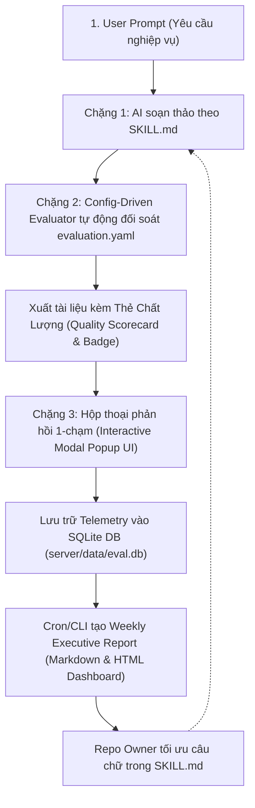

# HƯỚNG DẪN CẬP NHẬT HỆ THỐNG & TIÊU CHUẨN ĐÓNG GÓP AI SKILLS
## (AI Skills Evaluation System & Contribution Specification)

> **Mục tiêu:** Cung cấp tài liệu kỹ thuật chuẩn mực nhưng súc tích, dễ tiếp cận cho **Product Managers (PM), Business Analysts (BA), QA Leads và Developers** khi sử dụng hoặc đóng góp kỹ năng mới vào repository.

---

### 1. Tổng Quan Bản Cập Nhật (Overview)

Bản cập nhật nâng cấp kho lưu trữ `ai-skills` từ một **"Tập hợp Prompt tĩnh"** thành một **"Hệ thống Kỹ năng AI có Thẩm định Chất lượng Tự động (Automated Evaluation)"** và vòng lặp phản hồi khép kín (Continuous Feedback Loop):

* **Trước đây:** AI sinh tài liệu theo cảm tính dựa vào file hướng dẫn `SKILL.md`. Repo Owner không có số liệu đo lường tỷ lệ đạt chuẩn (Pass Rate), tỷ lệ phải chỉnh sửa (Rework Rate) hay các lỗi thường gặp của AI.
* **Hiện tại:** Mọi tài liệu do AI tạo ra đều được **đối soát tự động ngay lập tức với Bộ tiêu chí chất lượng (Rubric & Quality Gates)**, chấm điểm trên thang 100, thu thập phản hồi người dùng và tổng hợp thành Báo cáo điều hành hàng tuần (Weekly Executive Report).

---

### 2. Cấu Trúc Bộ 3 Thành Phần Của Một Skill (Skill Specification)

Mỗi kỹ năng trong thư mục `skills/<skill-name>/` bắt buộc phải có đầy đủ 3 thành phần kỹ thuật:

```text
skills/<skill-name>/
├── 1. SKILL.md             # System Prompt & Hướng dẫn nghiệp vụ
├── 2. evaluation.yaml      # Bộ tiêu chí thẩm định chất lượng (Rubric & Quality Gates)
└── 3. benchmarks/          # Bộ kịch bản kiểm thử đối chứng hồi quy (Tối thiểu 2 bài test)
    ├── tc-01-baseline.json   # Kịch bản kiểm thử nền tảng
    └── tc-02-realistic.json  # Kịch bản nghiệp vụ thực chiến chuyên sâu
```

#### Phân định vai trò kỹ thuật:
| Thành phần | File cấu hình | Vai trò & Ý nghĩa kỹ thuật |
| :--- | :--- | :--- |
| **System Prompt** | `SKILL.md` | Định nghĩa vai trò, ngữ cảnh, các bước phân tích, định dạng đầu ra và điều kiện kích hoạt (*Trigger conditions*) của AI. |
| **Grading Rubric** | `evaluation.yaml` | Bản đặc tả tiêu chuẩn nghiệm thu độc lập: Các phần bắt buộc (*Required Sections*), các lỗi phản mẫu bị cấm (*Prohibited Patterns*), trọng số điểm các chiều chất lượng (*Rubric Dimensions*) và ngưỡng điểm đạt (`pass_threshold: 80`). |
| **Regression Suite** | `benchmarks/` | Tập dữ liệu kiểm thử đối chứng gồm tối thiểu 2 bài (`tc-01-baseline` và `tc-02-realistic`), mỗi bài chứa: <br>• **Sample Good:** Mẫu đầu ra chuẩn mực (kỳ vọng $\ge 80$ điểm - `PASS`).<br>• **Sample Flawed:** Mẫu cố tình vi phạm lỗi nghiệp vụ (kỳ vọng $< 80$ điểm - `FAIL`) để xác minh bộ lọc hoạt động chính xác. |

---

### 3. Luồng Vận Hành Toàn Trình (3-Tier End-to-End Workflow)

Hệ thống tuân thủ nghiêm ngặt **Quy trình vận hành 3 Chặng bắt buộc (Mandatory 3-Tier Pipeline)**:



* **Trải nghiệm phía người dùng (1-Click Interactive Modal):** Bạn nhận được văn bản chuẩn chỉnh kèm theo **Bảng Thẻ Kiểm Định Chất Lượng** (Điểm số 4 chiều, Trạng thái Pass/Fail). Ngay sau đó, hệ thống tự động kích hoạt **hộp thoại tương tác đồ họa Modal UI** để bạn bấm chọn đánh giá 1-chạm (`[1] Rất hài lòng`, `[2] Cần bổ sung`, `[3] Điều chỉnh phạm vi`) mà không cần gõ phím thủ công.
* **Bảo mật dữ liệu (Strict Data Minimization):** Hệ thống **không gửi văn bản gốc, prompt hay dữ liệu kinh doanh của bạn**. Telemetry chỉ truyền metadata gồm: `event_id`, `skill_id`, `score`, `result`, và danh sách mã lỗi `issue_codes`. Dữ liệu feedback **tuyệt đối không tự động git push lên repo** mà lưu trữ an toàn trong SQLite cục bộ (`server/data/eval.db`).

---

### 4. Kiến Trúc Vận Hành Đã Chuẩn Hóa (/grill-me Alignment)

Toàn bộ 20 skills trong repository tuân thủ 4 nguyên tắc kiến trúc:

1. **Bộ máy đánh giá động (Config-Driven Universal Evaluator):** File lõi [rubric-evaluator.ts](file:///Users/krystalnguyen/Documents/ai-skills/ai-skills/evaluation/src/judge/rubric-evaluator.ts) hoạt động như một Engine độc lập, hoàn toàn **không hardcode** bất kỳ nghiệp vụ nào. Khi chấm điểm skill nào, engine tự động nạp `evaluation.yaml` của skill đó để tính điểm theo đúng barem và trọng số riêng.
2. **Độ phủ kiểm thử 100% (82 Automated Benchmarks):** Toàn bộ 20 kỹ năng đều được trang bị cặp bài test chuẩn `tc-01` và `tc-02`, đạt Pass Rate 50% đối chứng (100% Good đạt PASS, 100% Flawed bị FAIL).
3. **Thẩm định cách ly (Isolated Evaluation):** Tài liệu của kỹ năng nào chỉ chấm điểm dựa trên đúng file `evaluation.yaml` của kỹ năng đó, không áp đặt hay trừ điểm chéo tiêu chí của domain khác.
4. **Phản hồi tinh gọn (Pure Delivery):** Sau khi xuất kết quả và Thẻ đánh giá kèm Modal UI, Agent kết thúc lượt và chờ lệnh tiếp theo; không tự ý chào mời các kỹ năng kế tiếp.
5. **Kích hoạt có chọn lọc (Selective Triggering):** Chỉ kích hoạt bộ thẩm định khi người dùng yêu cầu các sản phẩm có cấu trúc chuẩn (PRD, BRD, WBS, Kiến trúc kỹ thuật, Test Automation...). Các câu hỏi tư vấn thông thường được phản hồi linh hoạt.

---

### 5. Hướng Dẫn Đóng Góp Skill Mới (Contributor Walkthrough)

Khi đóng góp một skill mới (ví dụ: `skills/api-contract-design/`), bạn thực hiện theo 5 bước chuẩn hóa:

#### Bước 1: Khởi tạo thư mục
Tạo thư mục tại `skills/<tên-skill>/` theo cấu trúc chuẩn.

#### Bước 2: Soạn thảo `SKILL.md`
Chứa YAML Frontmatter chuẩn và hướng dẫn nghiệp vụ:
```yaml
---
name: your-skill-name
description: >-
  Mô tả rõ năng lực của skill và điều kiện kích hoạt cụ thể (Triggers).
  Viết theo ngôi thứ ba.
metadata:
  author: "Tên Tác Giả / Đội Ngũ"
  version: "1.0.0"
  domain: "product-strategy | design-prototyping | quality-engineering | cognitive-learning | tooling-automation"
---
```

#### Bước 3: Định nghĩa Bộ Tiêu Chí `evaluation.yaml`
Quy định rõ các mục bắt buộc, các lỗi cấm và ngưỡng điểm:
```yaml
skill_id: your-skill-name
skill_version: 1.0.0
title: Tên Bộ Quy Chuẩn Nghiệp Vụ
task_types:
  - id: primary_task_type
    name: Tên loại tác vụ
    required_sections:
      - pattern: regex_pattern_mục_bắt_buộc
        name: Tên Mục Bắt Buộc
        severity: critical                     # critical | major | minor
prohibited_patterns:
  primary_task_type:
    - pattern: regex_phản_mẫu_cấm
      issue_code: ten_ma_loi_ky_thuat
      description: Lý do cấm mẫu này
      severity: critical                       # critical -> Instant Fail
rubric_dimensions:
  - dimension: completeness
    name: Độ Đầy Đủ
    weight: 0.30
  - dimension: soundness
    name: Tính Đúng Đắn & Chặt Chẽ
    weight: 0.35
  - dimension: actionability
    name: Tính Khả Thi Triển Khai
    weight: 0.20
  - dimension: clarity
    name: Định Dạng & Rõ Ràng
    weight: 0.15
scoring:
  pass_threshold: 80                           # Điểm sàn nghiệm thu
  critical_issue_behavior: instant_fail
```

#### Bước 4: Viết Bộ Test Case Benchmarks (`tc-01-baseline.json` & `tc-02-realistic.json`)
Chuẩn bị tối thiểu 2 bài kiểm thử (mỗi bài có cả 2 biến thể `sample_good_output` và `sample_flawed_output`):
1. `benchmarks/tc-01-baseline.json`: Kịch bản cơ sở kiểm tra tính đầy đủ của các mục cốt lõi.
2. `benchmarks/tc-02-realistic.json`: Kịch bản thực chiến chuyên sâu, tình huống biên phức tạp và các ràng buộc đa chiều.

Cấu trúc mỗi file JSON:
```json
{
  "id": "tc-01",
  "name": "Kịch bản kiểm thử mẫu",
  "task_type": "primary_task_type",
  "prompt": "Câu lệnh yêu cầu mẫu của người dùng",
  "expected_sections": ["Tên Mục Bắt Buộc"],
  "sample_good_output": "# Tiêu đề\nNội dung hoàn chỉnh, đáp ứng đầy đủ rubric...",
  "sample_flawed_output": "# Tiêu đề\nNội dung sơ sài, vi phạm lỗi cấm để kiểm tra bộ lọc..."
}
```

#### Bước 5: Chạy Tự Kiểm Tra (Self-Check CLI)
Trước khi tạo Pull Request, chạy lệnh kiểm thử cục bộ:
```bash
npm run eval <tên-skill>
```
* **Điều kiện nghiệm thu:** 
  * Cả hai bài kiểm thử `tc-01` và `tc-02` đều phải đạt:
    * `Sample Good`: Đạt `PASS` ($\ge 80/100$, 0 lỗi Critical).
    * `Sample Flawed`: Bị `FAIL` ($< 80/100$), bẫy chính xác các mã lỗi cấm đã cấu hình.
  * Tỷ lệ đạt chuẩn đối chứng phải đúng 50% (Good: 100% Pass, Flawed: 100% Fail).

---

### 6. Bảng Tra Cứu Câu Lệnh Vận Hành (CLI Cheatsheet)

| Lệnh thực thi | Vai trò sử dụng | Chức năng chi tiết |
| :--- | :--- | :--- |
| `npm run eval <skill>` | Contributor / Dev | Chạy kiểm thử tự động cục bộ cho 1 skill (đối soát `evaluation.yaml`, offline, an toàn). |
| `npm run eval:all` | Repo Owner / CI | Quét kiểm tra chất lượng hồi quy toàn bộ 20 skills (82 bài test benchmark) cùng lúc. |
| `npm run eval:all:send` | Repo Owner | Kiểm thử 20 skills và đồng bộ telemetry về Central Ingestion Server. |
| `npm run server` | DevOps / Owner | Khởi động Ingestion Server & SQLite Database (`server/data/eval.db`) tại `http://localhost:3456`. |
| `npm run report` | Repo Owner | Tổng hợp toàn bộ số liệu từ database và xuất Báo cáo tuần (Markdown & HTML Dashboard). |
| `npm run test:e2e` | Toàn bộ | Chạy thử nghiệm toàn trình: Chấm điểm $\rightarrow$ Ingestion DB $\rightarrow$ Xuất Báo cáo. |

---

### 7. Cách Repo Owner Khai Thác Báo Cáo Tuần (Executive Action Loop)

Hàng tuần khi nhận Báo cáo tại [`reports/weekly-YYYY-MM-DD.md`](../reports/) hoặc file HTML:
1. **Quét bảng Ma Trận Kỹ Năng (Section 2):** Xác định skill nào có Pass Rate thấp hoặc Rework Rate cao.
2. **Xem Top Lỗi Thường Gặp (Section 3):** Nhận diện điểm yếu cụ thể của AI (ví dụ: `missing_traceability_matrix` hay `raw_code_leakage_in_frd`).
3. **Hiệu chỉnh Prompt (`SKILL.md`):** Thêm chỉ dẫn bắt buộc hoặc quy tắc ngăn chặn trực tiếp vào điểm yếu được báo cáo.
4. **Kiểm tra lại (`npm run eval <skill>`):** Xác nhận điểm số tăng và lỗi biến mất trước khi phát hành phiên bản mới.
